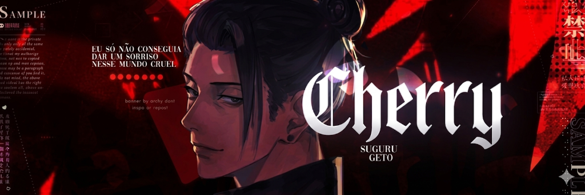

<div align="center">

<!-- Animated Header Text -->
<a href="https://git.io/typing-svg">
  
</a>

<br/>

<!-- Status Clearance Badges -->
[](https://github.com/loveslaw)
[](https://github.com/loveslaw)
[](https://github.com/loveslaw)

</div>

---

## ⚡ **About Cherry**

Independent Systems & Security Architect specializing in **high-performance asynchronous automation**, **low-level socket programming**, and **forensic-resistant tooling**. Passionate about cryptographic safety, zero-dependency engineering, and robust CLI/TUI ecosystems.

* **Primary Focus:** Low-level Linux/Windows IPC, Raw Sockets, Applied Cryptography (AES-256-GCM, Argon2).
* **Engineering Philosophy:** Zero bloat, maximum execution speed, impenetrable architecture.

---

### 🏆 **GitHub Global Trophies**

<div align="center">
  
</div>

---

## 💻 **Technical Arsenal**

<div align="center">

#### **Core Languages**


#### **Systems, Security & Networking**


</div>

---

## 🍒 **Flagship Operations & Projects**

<div align="center">

| Project | Stack | Overview | Access |
| :--- | :--- | :--- | :---: |
| **🛡️ GhostVault-CLI** | `Python` `AES-256-GCM` `Argon2` | Zero-knowledge cryptographic locker with decoy plausibility & DoD 5220.22-M 3-pass shredder | [**Inspect**](https://github.com/loveslaw/GhostVault-CLI) |
| **🔄 Discord-Server-Cloner** | `Python` `discord.py` `Asyncio` | Full lossless Discord backup engine snapshotting roles, hierarchies, permissions & 1-click clone | [**Inspect**](https://github.com/loveslaw/Discord-Server-Cloner) |
| **🖧 LAN-Sentry** | `Python` `Raw Sockets` `ARP` | High-speed subnet sniffer auditing 254 hosts in <2s with real-time intrusion webhook alerts | [**Inspect**](https://github.com/loveslaw/LAN-Sentry) |
| **🎫 Discord-Ticket-Engine** | `Python` `Asyncio` `HTML5` | Support ticket engine with persistent components & 1:1 dark theme offline HTML transcript generation | [**Inspect**](https://github.com/loveslaw/Discord-Ticket-Engine) |
| **⚡ FastHLS-Downloader** | `Python` `Multi-Threaded` `AES-128` | Multi-threaded HLS grabber downloading TS segments in 16x parallel threads with live decryption | [**Inspect**](https://github.com/loveslaw/FastHLS-Downloader) |

</div>

---

## 📊 **Telemetry & Live Activity**

<div align="center">


<br/>


</div>

---

## 🔗 **Encrypted Uplinks**

<div align="center">

[](https://github.com/loveslaw)
[](https://cherrygfx.netlify.app)
[](https://forcecy.netlify.app)
[](mailto:louiss010101@proton.me)

</div>

---

<div align="center">

```
>>> ARCHITECTURE: ACTIVE | ZERO COMPROMISE | CHERRY ECOSYSTEM <<<
```

**Always Learning. Always Building. Always Pushing Limits.**

</div>
